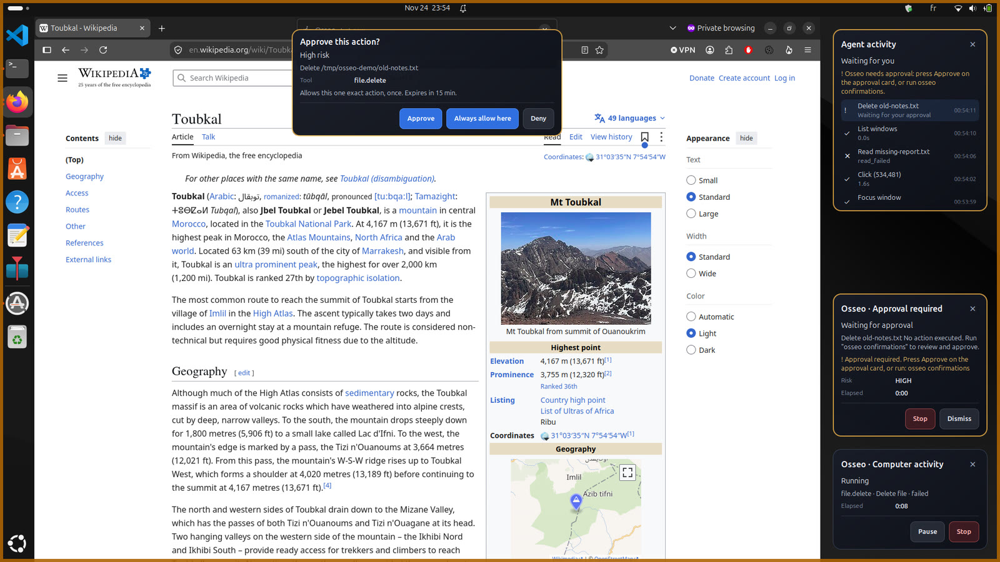
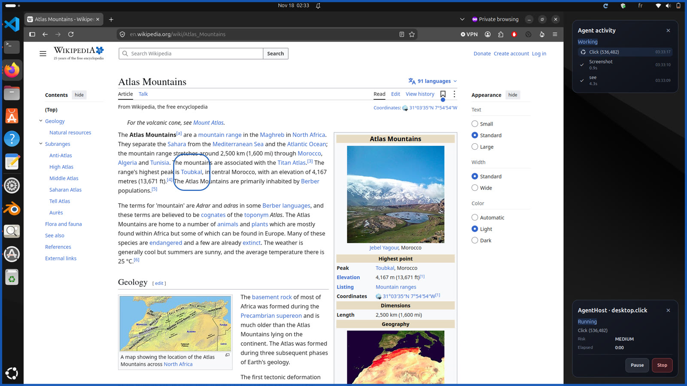
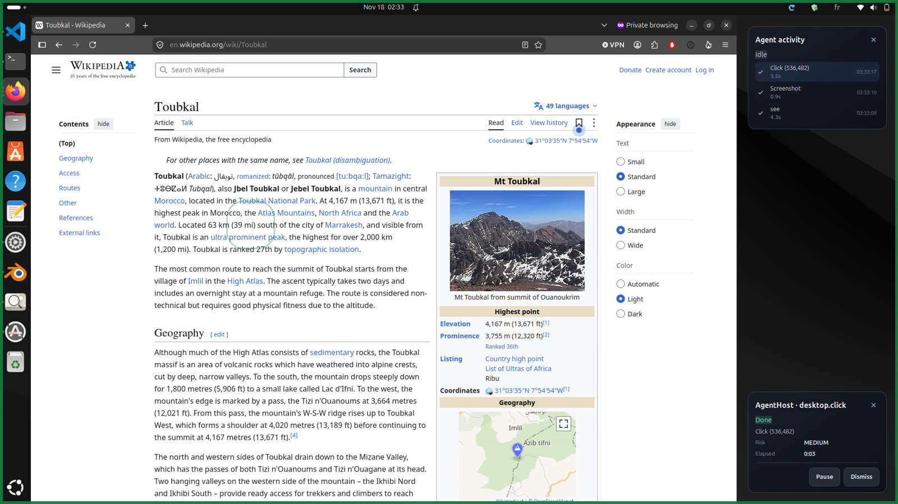
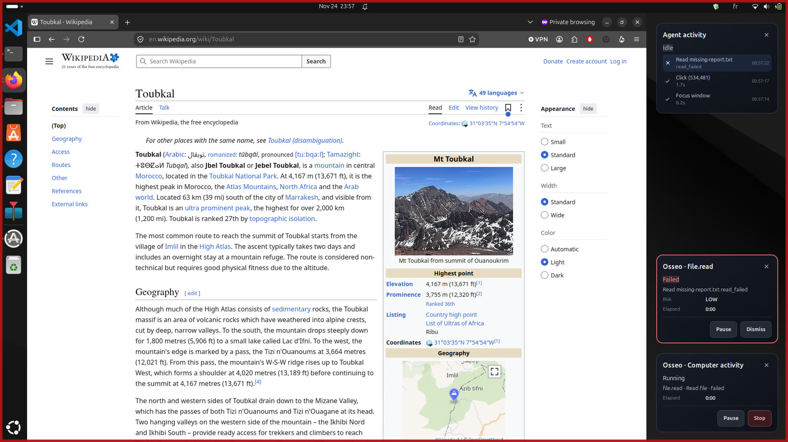

# Osseo

[](https://github.com/abdelazizfacoiti/Osseo/actions/workflows/ci.yml)
[](LICENSE)
[](docs/getting-started.md)

**Let any AI agent use your computer, while you see every step and can stop it.**

Osseo is a local MCP server. Connect it to Claude Code, Codex, Cursor, Copilot or OpenCode, and the agent can open apps, click, type, read files, run commands and drive a browser. The edge of your screen and a side panel show what it is doing, and anything risky waits for you.

<!-- Launch day: drag ~/Videos/Osseo-demo/osseo-demo-720p.mp4 into a GitHub comment and paste the link here (2 minutes: one prompt designs a chair in Blender through the GUI, renders it and lists it on Shopify). -->



## Quick start (Linux, 2 minutes)

Needs Linux x86_64 with X11 (or Wayland through XWayland) and Node 20+.

```bash
git clone https://github.com/abdelazizfacoiti/Osseo.git
cd Osseo
npm ci && npm run build && npm run release:build
OSSEO_ARCHIVE="$PWD/release/osseo-linux-x64.tar.gz" sh scripts/install.sh
osseo setup guide
```

`setup guide` checks your desktop packages, runs a self-test, finds your agent clients and prints the one command that connects each of them. For Claude Code it is:

```bash
claude mcp add osseo --scope user -- osseo start
```

Restart the client and try: *"Use Osseo to open https://example.com and tell me what you see."*

<details>
<summary>Other clients</summary>

```bash
osseo integrations <client> add --apply   # opencode, claude, codex, copilot, copilot-cli, cursor
```

Any MCP client can use:

```json
{ "mcpServers": { "osseo": { "command": "osseo", "args": ["start"] } } }
```

</details>

<details>
<summary>Claude Code auto mode blocks Osseo calls</summary>

Let Claude Code run Osseo's tools without asking again. Osseo itself still asks you before sends, uploads, deletes and payments.

```bash
osseo integrations claude add --allow-tools all --apply   # or: read (status, windows, see, wait)
```

In prompts, say "use Osseo" rather than "don't use MCP": Osseo is itself an MCP server.

</details>

## What you see

The screen edge shows the state at a glance, and the panel on the right keeps a timeline of every action with Pause and Stop. Several agent sessions share one panel through a small local host, so they never fight over the screen.

| Edge | Meaning |
|---|---|
| Gray | on and idle (with `"overlay": { "frame": "always" }` in `~/.config/osseo/config.json`); it fades after 2 minutes without an action (`"frameIdleMs"`, 0 keeps it) |
| Blue | an action is running |
| Green | done |
| Amber | waiting for your approval, or paused |
| Red | an action failed |

| Running | Done | Failed |
|---|---|---|
|  |  |  |

## What it does

- **Sees and acts by number.** `see` lists a window's controls as `[1] button "Save"`, and `click`, `type`, `key`, `scroll` take the number. Typed values are read back, and every action reports whether the screen changed.
- **Picks the best route.** Browser pages and accessibility trees come before screenshots and pixel clicks.
- **Fast.** On our benchmark a verified key takes 0.4 s and reading a window takes 50 ms with an accessibility tree. `steps` and `key {sequence}` batch routine work into one call ([measurements](docs/notes/speed-plan.md)).
- **Drives a browser** on its own Chrome profile, never yours.
- **Files and shell**, with protected system paths blocked.
- **Tasks and workflows.** Save steps as workflows and run them on a schedule.
- **Guide mode.** For apps the agent must not drive, it shows you where to click instead.

## Safety

- Sends, uploads, deletes, payments and private-data reads need your approval of the exact action, once, for 15 minutes.
- Approve in your client's chat, on the on-screen card (only a real mouse press counts) or with `osseo confirm <id>`.
- Password, one-time-code and card fields are refused. Credential and security apps are blocked.
- Pause and Stop are always on screen, and the agent cannot press them.
- Every call is written to a redacted audit log. Screenshots and typed text are never logged.
- Rules live in `~/.osseo/policy.toml` (`osseo policy`).

## Platforms

See [platforms](docs/platforms.md) for detail.

| Platform | Status |
|---|---|
| Linux x86_64 (X11, Wayland through XWayland) | Supported |
| Windows 10/11 | In progress: desktop tools pass their checks, cards are opt-in, the installer is not yet release-tested |
| macOS | Not started |

## More

[Docs](docs/INDEX.md) · [Getting started](docs/getting-started.md) · [How it works](docs/how-it-works.md) · [Safety](docs/safety.md) · [Tools](docs/tools.md) · [Platforms](docs/platforms.md) · [Agent skill](skills/osseo/SKILL.md) · [Contributing](CONTRIBUTING.md)

Early software with a single maintainer; tool names and configuration may change. Apache-2.0, see [LICENSE](LICENSE).

Osseo is an independent project, not affiliated with or endorsed by Anthropic, OpenAI, GitHub, Microsoft or Cursor. Product names are trademarks of their owners and are used only to say which clients it works with.
