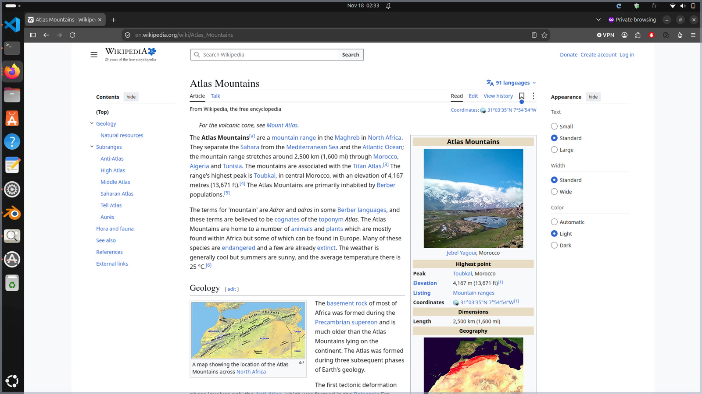

# AgentHost

[](https://github.com/abdelazizfacoiti/AgentHost/actions/workflows/ci.yml)
[](LICENSE)
[](docs/08_RELEASE_AND_OPERATIONS.md)

**A local MCP server that lets an AI agent use your computer, while you see every step and can stop it.**

Connect AgentHost to any MCP client (Claude Code, Codex, Cursor, Copilot, OpenCode and others). The agent can open apps, click, type, read files, run commands and drive a browser. A panel on your screen shows each action as it happens, with Pause and Stop.

## See it work

Screenshots from a real run on Linux (X11) in Firefox: the agent reads a page, clicks a link, asks before deleting a file, and fails on a window that does not exist. The colour of the screen edge says what AgentHost is doing at a glance, and the dock on the right keeps a timeline of every action, with Pause and Stop.

| Edge frame | Meaning |
|---|---|
| Gray | AgentHost is on and idle |
| Blue | an action is running |
| Green | it finished |
| Amber | waiting for your approval, or paused |
| Red | an action failed |

**Idle.** Nothing is happening. Only a thin gray frame shows, and the browser uses the whole screen.



**Running.** A blue frame, and a ring over the link the agent is about to click. The dock reserves its own strip, so the browser makes room, and it lists each action as it happens.


**Done.** A green frame, a Done card, and a green pulse where the click landed. The page changed, and the timeline shows what was done.


**Asks first.** Deleting a file stops and shows the exact action. One approval covers that action once and expires after 15 minutes.


**Failed.** A red frame and a plain reason.


The always-on gray frame is optional. Add `"overlay": { "frame": "always" }` to `~/.config/agenthost/config.json` and restart your agent client. The frame, ring and dock are drawn on Linux (X11). Windows draws cards only for now.

## What it does

- **Sees and acts by number.** `see` lists a window's controls as `[1] button "Save"`; `click`, `type`, `key`, `scroll` and `drag` take the number. Typed values are read back, and every action reports whether the screen changed.
- **Uses the best route first.** Browser pages and accessibility trees come before screenshots and pixel clicks.
- **Drives a browser** on its own Chrome profile (never yours), or on sites you allow in your own browser through the extension.
- **Works with files and shell**, with protected system paths blocked.
- **Runs tasks and workflows.** Track work as tasks with a checklist, save steps as parameterised workflows, and run them on a schedule.
- **Guide mode.** For apps the agent must not drive, it draws labelled boxes on what you should click. It never clicks.
- **Stays out of your way.** Background mode runs the agent on a hidden display with a small viewer.

## Safety

- Sending, uploading, deleting, paying and reading private data need your approval of the exact action. Each approval works once and expires after 15 minutes.
- Approve in your MCP client's chat, on an on-screen card (only a real mouse press counts), or in a terminal with `agenthost confirm <id>`.
- Password, one-time-code and card fields are refused. Credential and security apps are blocked.
- Rules live in `~/.agenthost/policy.toml`; edit them with `agenthost policy`.
- Pause and Stop are always on screen, and the agent cannot press them.
- Every call goes to a redacted audit log. Screenshots and typed text are never logged.

## Quick start

Linux x86_64 (X11, or Wayland through XWayland) and Node 20+:

```bash
curl -fsSL https://raw.githubusercontent.com/abdelazizfacoiti/AgentHost/main/scripts/install.sh | sh
agenthost doctor
agenthost setup
```

The installer checks the SHA-256, installs under `~/.local` without `sudo`, and is safe to run again. `doctor` lists missing desktop packages; nothing is installed silently.

Register the server with your client (previews first; `--apply` writes it):

```bash
agenthost integrations <client> add --apply   # opencode, claude, codex, copilot, copilot-cli, cursor
```

Reload the client; it starts AgentHost itself. Any other MCP client can use:

```json
{ "mcpServers": { "agenthost": { "command": "agenthost", "args": ["start"] } } }
```

Check it works with `agenthost selftest`, then ask the agent: *"Open Firefox and take a screenshot."*

<details>
<summary>Windows (untested)</summary>

Needs 64-bit Windows and Node 20+. Download `install.ps1`, read it, then run it. Do not pipe a web page into `iex`.

```powershell
powershell -ExecutionPolicy Bypass -File install.ps1
```

It installs under `%LOCALAPPDATA%\AgentHost` without administrator rights. The desktop adapter and on-screen cards are not yet verified on a real Windows machine. See [docs/13_PLATFORMS.md](docs/13_PLATFORMS.md).

</details>

<details>
<summary>Build from source</summary>

```bash
git clone https://github.com/abdelazizfacoiti/AgentHost.git
cd AgentHost
npm ci && npm run build && npm test
```

Use an isolated home for experiments: `export AGENTHOST_HOME="$PWD/.agenthost"`.

</details>

## Platform support

| Platform | Status |
|---|---|
| Linux x86_64 (X11, Wayland through XWayland) | Supported |
| Windows | In progress, untested |
| macOS | Not started |

## Documentation

[Index](docs/INDEX.md) · [Architecture](docs/02_SYSTEM_ARCHITECTURE.md) · [Tools](docs/03_MCP_TOOLS_AND_ADAPTERS.md) · [Security](docs/04_SECURITY_PERMISSIONS_AND_LOGGING.md) · [Platforms](docs/13_PLATFORMS.md) · [Release and operations](docs/08_RELEASE_AND_OPERATIONS.md) · [Privacy](docs/11_PRIVACY_AND_SUPPORT.md) · [Agent skill](skills/agenthost/SKILL.md) · [Contributing](CONTRIBUTING.md) · [Security policy](SECURITY.md)

## Status

Early software with a single maintainer. Tool names and configuration may change between releases. Bug reports and run reports (`agenthost task export <id>`) are welcome as issues.

## License

Apache-2.0. See [LICENSE](LICENSE) and [NOTICE](NOTICE).
